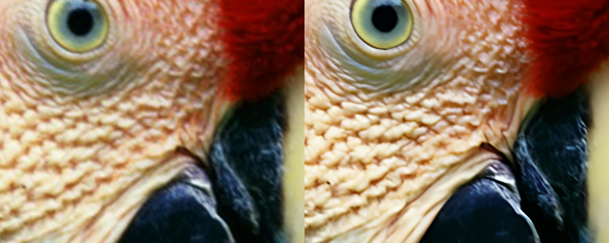

# Crispwall

Make any picture a sharp wallpaper for your exact screen. It runs in your browser, and your picture never leaves
your device.

**[Open Crispwall](https://atuuuuuuu.github.io/crispwall/)**



Left: a 512-pixel photo stretched to fit a MacBook Air the normal way. Right: the same photo through Crispwall.

## Why I made this

When I got my Mac, every wallpaper I liked looked blurry on it. My fix was to download the picture, run it through
an AI upscaler website, crop it to the right size, save it to Photos and then set it. The upscaler sites limited me
to a few pictures a day, added watermarks, and wanted my photos on their servers.

Crispwall does all of that on one page:

- It knows the pixel size of your screen. Open it on your phone and it picks your phone. There's also a list of
  iPhones, Android phones, iPads, MacBooks, iMacs and normal monitors (1080p, 1440p, 4K, ultrawide).
- It shows the picture inside a phone or laptop frame, with the clock and the notch, so you can drag it until
  nothing important is hidden.
- If the picture is too small for your screen, it upscales it with Real-ESRGAN, an AI model trained to rebuild
  edges and texture. If the picture is already big enough, it just crops it.
- You get a PNG at exactly your screen's size. On a phone you can save it straight to Photos.

It's free. There's no account, no watermark and no daily limit.

## Your picture stays on your device

The AI model (5 MB) downloads once and runs in your browser, on your graphics chip through WebGPU when the browser
supports it, and on the processor otherwise. The page has a Content Security Policy that only allows connections
to its own site, so even a bug couldn't send your picture somewhere else. The end-to-end test checks that no
request leaves the page.

On my MacBook Air a 13" MacBook wallpaper takes about 2 seconds on the graphics chip and about 13 seconds without
it.

## What it can't do

The AI sharpens edges and texture, but it can't invent detail that was never there. A tiny thumbnail (less than a
quarter of your screen's width) will still look soft, and Crispwall tells you when that happens. HEIC photos only
open in Safari, because other browsers can't read them yet.

## Run it yourself

```sh
git clone https://github.com/atuuuuuuu/crispwall.git
cd crispwall
npm install
npm run dev
```

`npm test` runs the unit tests and `npm run e2e` runs the browser tests: they upscale a real picture and check the
file size, that the result is sharper than a normal resize, and that nothing was sent over the network.

The model file is `realesr-general-x4v3` from [Real-ESRGAN](https://github.com/xinntao/Real-ESRGAN), converted to
ONNX. The conversion matches the original PyTorch model to within 0.00001 per pixel.

## License

MIT, made by [atu](https://github.com/atuuuuuuu). Real-ESRGAN is by Xintao Wang and others under the BSD 3-Clause
license (see `public/models/LICENSE-Real-ESRGAN.txt`).
